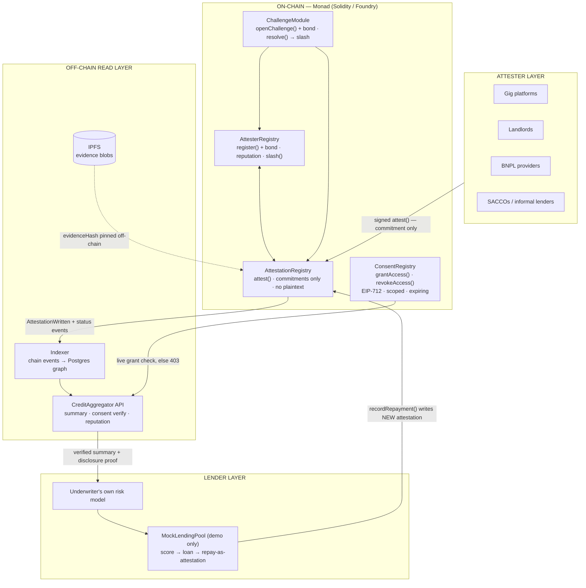
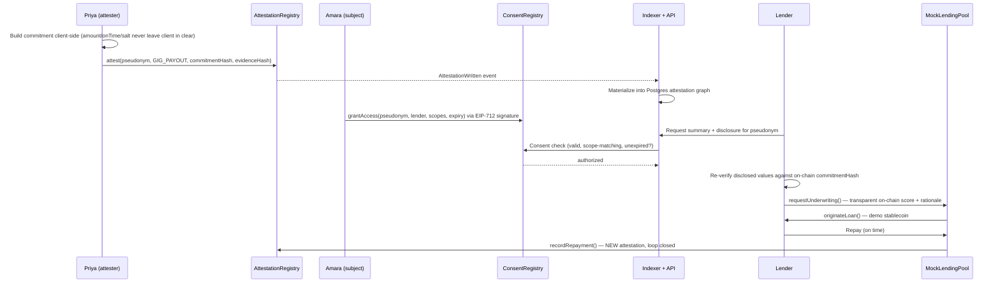
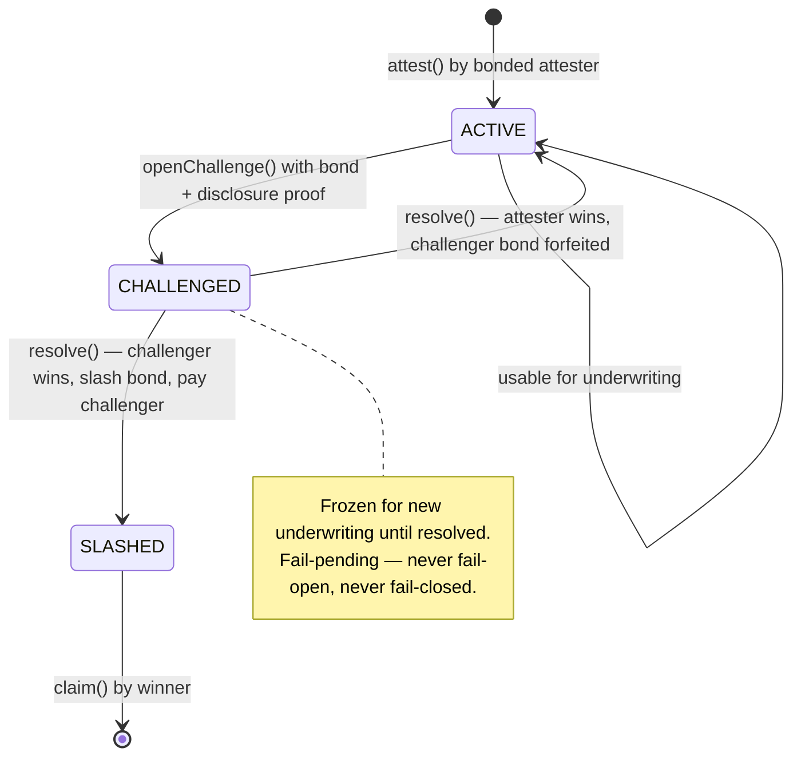
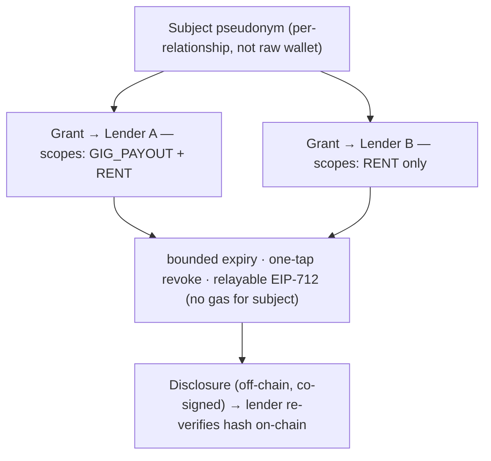
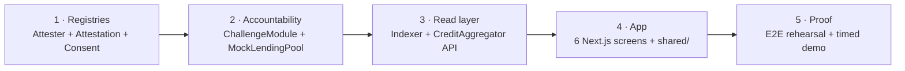

# Vouchain (Credent)

**A permissionless, on-chain credit-attestation layer that turns real-world
payment behavior into portable, user-owned credit identity — built on Monad.**

Billions of people pay rent, repay informal loans, and earn gig income on
time, every time — and none of it counts toward any credit score anywhere.
Vouchain lets any verifier that was *actually there* (a landlord, a BNPL
provider, a gig platform, a SACCO, a peer lender) write a signed, portable
attestation about that payment behavior to a public ledger the *person*
owns — so the behavior becomes capital the next lender can underwrite
against. No bureau, no bank, no starting from zero at every platform,
border, or informal-to-formal boundary.

> Source of truth: [`prd/Credent-prd.md`](../prd/Credent-prd.md) (v3).
> This README is the map; the PRD is the territory.
> Build rules and agent routing: [`AGENTS.md`](./AGENTS.md).
> Live project state: [`ANCHOR.md`](./ANCHOR.md).

---

## What it is — and what it is not

- **It is an evidence layer.** Signed facts (`this wallet paid this
  obligation, on this date`) with signatures a lender re-verifies
  independently — then plugs into their *own* risk model.
- **It is not a credit score.** We never opine approve/deny. Scoring is a
  separate, competitive layer we deliberately don't own.
- **It is not a lender.** `MockLendingPool` is a demo contract proving the
  data is underwriting-usable — not a real lending product.
- **It is not KYC/identity.** We attest to behavior tied to a
  per-relationship *pseudonym*, not to legal identity. Identity-binding is
  a deliberate non-goal for v1.

---

## System architecture



### The trust spine

Attesters *propose* a commitment; bonding, a challenge window, and
consent-scoped disclosure decide what gets trusted and what gets seen —
the subject's own say-so decides neither.



### Accountability: the challenge path

Standing belongs to whoever **relied on the disclosure and bears the loss
if it's false** (the lender) — never the subject alone, who benefits from
flattering attestations and would never flag them.



### Consent model: scoped, expiring, revocable

Scopes are `keccak256(eventType)` — per-event-type grants, never
all-or-nothing. Amara shares `GIG_PAYOUT` + `RENT` with one lender while
withholding `P2P_LOAN_REPAYMENT`, and revokes with one tap.



---

## Smart contracts (Monad testnet, Foundry)

| Contract | Key functions | Invariant |
|---|---|---|
| `AttesterRegistry.sol` | `register()` + `MIN_BOND`, `topUpBond()`, `slash()` (`onlyChallengeModule`), `adjustReputation()` | No bond, no attester. Reputation moves only on challenge outcomes, never on volume. |
| `AttestationRegistry.sol` | `attest()` (active bonded attesters only), `markChallenged/markSlashed` (`onlyChallengeModule`), `markDisputedBySubject()` | Storage holds `subjectPseudonym` + `commitmentHash` + `evidenceHash` — **never** plaintext amount/onTime/address. |
| `ConsentRegistry.sol` | `grantAccess()` / `revokeAccess()` (EIP-712 verified, relayable), `isAuthorized()` | Bounded, future-dated grants; revocation stops new disclosures immediately. |
| `ChallengeModule.sol` | `openChallenge()` (bond + disclosure proof), `submitDefense()`, `resolve()` (`onlyArbiter` — interim centralization, labeled as such), `claim()` | Relying-party standing; spam costs a bond; late challenges revert. |
| `MockLendingPool.sol` *(demo only)* | `requestUnderwriting()`, `originateLoan()`, `recordRepayment()` → new attestation | Never touches core storage except through registry interfaces. |

### Commitment & disclosure schema

```solidity
// ON-CHAIN (AttestationRegistry stores this — nothing else)
commitmentHash = keccak256(abi.encode(
    subjectPseudonym, eventType, amount, onTime, timestamp, salt));
```

```jsonc
// OFF-CHAIN disclosure (co-signed, delivered only to consented viewer)
{
  "attestationId": 10432,
  "amount": 42.50, "currency": "USD",
  "onTime": true, "timestamp": 1760000000,
  "salt": "0x4e1f…",
  "attesterSignature": "0x…",
  "subjectCoSignature": "0x…"
}
```

A verifier recomputes the hash and checks it against the on-chain
`commitmentHash` **before** displaying, scoring, or underwriting —
mismatch means reject, client-side, always.

### Event types (closed set)

`RENT` · `BNPL_INSTALLMENT` · `GIG_PAYOUT` · `P2P_LOAN_REPAYMENT` ·
`UTILITY_BILL` — nothing else without a PRD design note.

---

## Off-chain: indexer + CreditAggregator API

A lightweight service subscribes to chain events and materializes them
into Postgres as the queryable attestation graph. Read-only mirror —
never originates state; lenders can always recompute from the chain.

| Endpoint | Gate | Returns |
|---|---|---|
| `GET /subjects/:pseudonym/summary` | `X-Consent-Token` (live `ConsentRegistry` check) | `{ onTimeRate, attestationCount, attesterDiversity, tenureDays, disputeCount }` — public methodology, re-computable |
| `POST /consent/verify` | — | `{ authorized, expiry }` |
| `GET /attesters/:address/reputation` | public | `{ reputationScore, bond, attestationCount, challengesLost }` |

No valid, non-expired, scope-matching grant → `403` naming the missing
scope. Redis caches consent-tokens/sessions only — never attestation
data. Evidence blobs (receipt/contract/screenshot + attester note +
file hash) are pinned to IPFS; only the content hash reaches the chain.

---

## Frontend: 6 MVP screens (Next.js + wagmi/viem)

1. **Attester dashboard** — "Log a payment" form (hashed client-side into
   a commitment *before* submission) + live bond/reputation.
2. **Subject "My Record"** — plain language ("Your ride-hailing platform
   confirmed 24 on-time payouts"), active grants with one-tap revoke, no
   raw hex by default.
3. **Consent grant flow** — pick lender, pick event-type scopes, pick
   expiry, sign once (session-key/AA — no gas step for the subject).
4. **Lender underwriting console** — request access → disclosed
   summary/proof → transparent score → originate demo loan.
5. **Challenge console** — flagged attestation → challenge with bond →
   live resolution + bond/reputation change.
6. **Public attester explorer** — reputation, bond, counts, dispute
   history, world-readable. This transparency is what makes bonding a
   real deterrent instead of a theoretical one.

---

## Demo script (under 3 minutes)

| Time | Beat |
|---|---|
| 0:00–0:20 | The problem, one line: two years of perfect gig history, invisible; ~80% APR informal offer for a $400 loan. |
| 0:20–0:50 | Mock gig-platform webhook writes a commitment live (<1s on Monad); no plaintext on the explorer. |
| 0:50–1:20 | "My Record" in plain language; scoped consent grant (`GIG_PAYOUT` only). |
| 1:20–1:50 | Lender re-verifies the hash itself, sees the transparent score, originates the demo loan. |
| 1:50–2:30 | **The climax:** a planted false attestation gets challenged; the attester's bond is slashed live; explorer reputation drops. |
| 2:30–3:00 | "Commitments, not plaintext. Bonding + challenge window, not blind trust." Close: the evidence layer a score should have run on all along. |

---

## Initial core codebase — what it looks like

Build order (each slice lands only when its tests + demo path are green):



Planned file tree (contracts first; nothing below exists yet except the
workflow layer):

```
Credent/
├── README.md / AGENTS.md / ANCHOR.md      # docs, routing, state
├── .opencode/agents/*.md                  # 8 subagents (5 builders + 3 support)
├── .opencode/skills/*/SKILL.md            # 11 skills (6 domain + 5 shared)
├── contracts/                             # Foundry — attestation-contracts-agent + challenge-lending-agent
│   ├── foundry.toml                       # Monad testnet RPC + local anvil profiles
│   ├── src/
│   │   ├── AttesterRegistry.sol           # bonding, reputation, slash (onlyChallengeModule)
│   │   ├── AttestationRegistry.sol        # commitment writes, status machine
│   │   ├── ConsentRegistry.sol            # EIP-712 scoped grants
│   │   ├── ChallengeModule.sol            # bonds, window, arbiter resolve, claim
│   │   └── MockLendingPool.sol            # DEMO ONLY — score → loan → repay-as-attestation
│   ├── script/Deploy.s.sol                # testnet + fork deploys; addresses → ANCHOR.md
│   └── test/*.t.sol                       # bond/commitment/consent/challenge/loan-loop tests
├── indexer/                               # indexer-aggregator-agent (Node/TS)
│   ├── src/subscriber.ts                  # JSON-RPC event subscription (reorg-aware)
│   ├── src/graph.ts + schema.sql          # Postgres materialized attestation graph
│   ├── src/api.ts                         # summary / consent verify / reputation routes
│   ├── src/ipfs.ts                        # evidence pinning (content hash only on-chain)
│   └── src/consent.ts                     # live ConsentRegistry gating (else 403)
├── shared/                                # single source of truth for types + crypto
│   ├── types.ts                           # EventType, Attestation, Consent, Challenge
│   ├── commitments.ts                     # THE canonical hash helper (field order == contract)
│   ├── eip712.ts                          # typed-data defs for grants + disclosures
│   ├── constants.ts                       # deployed addresses, MIN_BOND, windows
│   └── abis/                              # generated from forge build
├── frontend/                              # frontend-agent (Next.js + wagmi/viem + Tailwind)
│   └── app/
│       ├── attester/   (log-a-payment + bond status)
│       ├── record/     (My Record + revoke)
│       ├── consent/    (grant flow)
│       ├── lender/     (underwriting console)
│       ├── challenge/  (challenge console)
│       └── explorer/   (public attester explorer)
│       ├── components/  (shared UI atoms — plain-language record cards, badges)
│       └── lib/         (wagmi/viem clients, consent-signing hooks)
└── ../prd/Credent-prd.md              # product source of truth — READ-ONLY
```

Key files and the exact job each does on day one:

| File (first to exist) | Job | Owner |
|---|---|---|
| `contracts/src/AttesterRegistry.sol` | Bonded registration, reputation, `onlyChallengeModule` slash | attestation-contracts-agent |
| `contracts/src/AttestationRegistry.sol` | Commitment writes, `ACTIVE → CHALLENGED → SLASHED` status | attestation-contracts-agent |
| `contracts/src/ConsentRegistry.sol` | EIP-712 scoped grants, relayable, revocable | attestation-contracts-agent |
| `contracts/src/ChallengeModule.sol` | Challenger bond, window, arbiter resolve, winner claim | challenge-lending-agent |
| `contracts/src/MockLendingPool.sol` | Transparent score → demo loan → repayment-as-attestation | challenge-lending-agent |
| `shared/commitments.ts` | Canonical hash helper — byte-identical to the contract | frontend-agent (with contracts-agent) |
| `indexer/src/subscriber.ts` | Event → Postgres materialization | indexer-aggregator-agent |
| `frontend/app/record/` | The screen judges must *feel* — plain-language My Record | frontend-agent |

---

## Getting started (once the contracts slice lands)

```bash
# Contracts — build, test, deploy to Monad testnet
cd contracts && forge build          # must be warning-free
cd contracts && forge test           # must be green
cd contracts && forge script script/Deploy.s.sol \
  --rpc-url $MONAD_RPC_URL --broadcast   # record addresses in ANCHOR.md

# Read layer + app (slices 3–4)
cd indexer && bun install && bun test
cd frontend && bun install && bun run build
```

Environment: copy `.env.example` (placeholders only — real keys never
enter git, AGENTS.md rule 6). You need a Monad testnet RPC URL and a
funded deployer key for the deploy step.

---

## Current status

Workflow layer is built and pushed; **no product code exists yet**.
`contracts/`, `indexer/`, `frontend/`, `shared/` are unbuilt — the tree
above is the blueprint, in the exact build order shown. See
[`ANCHOR.md`](./ANCHOR.md) for what's true right now and what's next.

## How work gets done here

1. Every session starts by reading `AGENTS.md` (rules + routing) and
   `ANCHOR.md` (state) — then loads the `vouchain-dev` skill for the map.
2. Tasks route to one of 8 subagents (`.opencode/agents/`), each loading
   its skills from the roster in `AGENTS.md` §5.
3. Every task closes: implement → review (`code-review-agent`) → atomic
   commit (`git-commit-agent`) → `ANCHOR.md` update. No push until asked.

## Honest limits (stated plainly, per PRD §20)

Bonding + challenges make fakery **costly, not impossible** — a
well-funded colluding ring can still out-stake the challenge cost.
Abandoning a wallet sheds bad history, so Vouchain proves *positive*
behavior is portable; it does **not** make negative history
unavoidable. Shown attestations are a borrower's best face, not a
representative sample. Capital supply, collections/recourse, and fiat
ramps are open gaps, not hidden ones. The demo labels every interim
mechanism (signed disclosure, single arbiter, mock pool) as interim.
...[truncated 1583 chars]